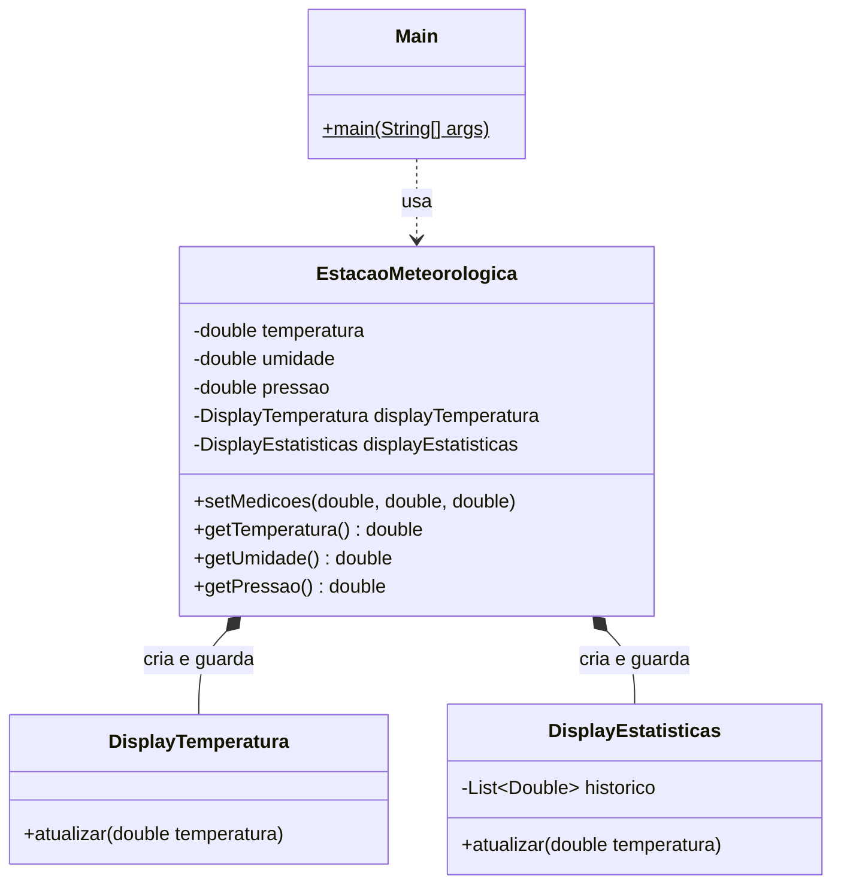
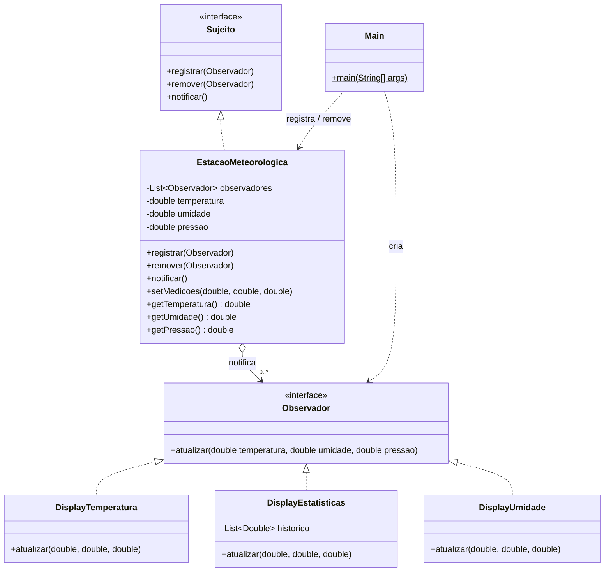

# Exercício 2: Rastreando o anti-pattern em um projeto real — Observer

Projeto analisado: `projeto_observer_antipattern` (estação meteorológica, Maven, Java 17).
Pacote: `br.venson.net.designpatterns.observer`

---

## 1. Por que guardar `DisplayTemperatura` e `DisplayEstatisticas` é um acoplamento forte?

Porque a `EstacaoMeteorologica` depende das **classes concretas** dos displays, e não de uma abstração:

```java
private final DisplayTemperatura displayTemperatura = new DisplayTemperatura();
private final DisplayEstatisticas displayEstatisticas = new DisplayEstatisticas();
```

O acoplamento aparece em quatro níveis:

- **Conhece os tipos concretos:** a estação importa/declara `DisplayTemperatura` e `DisplayEstatisticas` explicitamente.
- **Cria os próprios colaboradores:** o `new` está dentro da estação, então quem decide quais displays existem é a estação, e não quem a usa.
- **Conhece as assinaturas:** ela chama `atualizar(temperatura)` em cada um. Se a assinatura de um display mudar, a estação precisa mudar junto.
- **Conhece a ordem e o conteúdo da atualização:** ela decide quais dados cada display recebe (só `temperatura`), mesmo sendo dona de umidade e pressão.

O sujeito (quem produz os dados) deveria saber apenas que "existe alguém interessado nas mudanças", e não *quem* é esse alguém. Aqui, o sujeito conhece todos os interessados pelo nome, então uma mudança em qualquer display propaga para a estação (e vice-versa). Isso fere o princípio de **programar para uma interface** e o **Open/Closed** (a estação não é fechada para modificação quando surgem novos displays).

---

## 2. O que é preciso alterar para adicionar um `DisplayUmidade`? (pontos tocados)

Mesmo que `DisplayUmidade` seja uma classe nova, a **`EstacaoMeteorologica` precisa ser editada em 3 pontos**:

1. **Novo atributo:** `private final DisplayUmidade displayUmidade = new DisplayUmidade();`
2. **Nova chamada dentro de `setMedicoes(...)`:** `displayUmidade.atualizar(umidade);`
3. **Novo import/dependência** da classe concreta (no mesmo pacote não há `import`, mas a dependência de compilação existe).

Além disso:

- A **assinatura de `atualizar`** do novo display é diferente (recebe `umidade`, não `temperatura`), o que mostra que não existe um contrato comum entre os displays.
- A estação precisa ser **recompilada e reimplantada**, mesmo sem nenhuma mudança na lógica de medição.

**Total:** 1 classe nova (`DisplayUmidade`) + 1 classe existente alterada em 2–3 pontos (`EstacaoMeteorologica`). O `Main` não precisa mudar apenas porque o display está "escondido" dentro da estação, o que na verdade também é um problema: o cliente não controla nada.

---

## 3. Por que não dá para registrar/remover um display em tempo de execução? O que faltaria?

Porque os displays são **campos `final` instanciados na declaração**: o conjunto de displays é fixado em tempo de compilação. Não existe nenhum método público que receba um display de fora, e não existe nenhuma estrutura onde guardar "um número variável" de displays.

O que faltaria:

1. **Uma abstração comum** para os displays (uma interface `Observador` com `atualizar(...)`), para que a estação possa tratar qualquer display de forma uniforme.
2. **Uma coleção** de observadores na estação (`List<Observador>`), em vez de campos fixos.
3. **Métodos de registro e remoção** (`registrar(Observador)` e `remover(Observador)`), para que o código cliente (por exemplo o `Main`) possa incluir e retirar displays enquanto o programa roda.
4. **Um método de notificação** (`notificar()`) que percorra a coleção, em vez de chamadas escritas à mão para cada display.

Esses quatro itens são exatamente a estrutura do padrão Observer.

---

## 4. Refatoração com o padrão Observer

### 4.1 Diagrama de classes — ANTES



### 4.2 Diagrama de classes — DEPOIS




### 4.3 Código refatorado

**`Observador.java`** — interface do observador

```java
package br.venson.net.designpatterns.observer;

public interface Observador {

    void atualizar(double temperatura, double umidade, double pressao);
}
```

**`Sujeito.java`** — interface do sujeito (registra, remove e notifica)

```java
package br.venson.net.designpatterns.observer;

public interface Sujeito {

    void registrar(Observador observador);

    void remover(Observador observador);

    void notificar();
}
```

**`EstacaoMeteorologica.java`** — sujeito concreto

```java
package br.venson.net.designpatterns.observer;

import java.util.ArrayList;
import java.util.List;

public class EstacaoMeteorologica implements Sujeito {

    private final List<Observador> observadores = new ArrayList<>();

    private double temperatura;
    private double umidade;
    private double pressao;

    @Override
    public void registrar(Observador observador) {
        if (observador != null && !observadores.contains(observador)) {
            observadores.add(observador);
        }
    }

    @Override
    public void remover(Observador observador) {
        observadores.remove(observador);
    }

    @Override
    public void notificar() {
        // Copia defensiva: permite que um observador se remova durante a notificacao.
        for (Observador observador : new ArrayList<>(observadores)) {
            observador.atualizar(temperatura, umidade, pressao);
        }
    }

    public void setMedicoes(double temperatura, double umidade, double pressao) {
        this.temperatura = temperatura;
        this.umidade = umidade;
        this.pressao = pressao;
        notificar();
    }

    public double getTemperatura() {
        return temperatura;
    }

    public double getUmidade() {
        return umidade;
    }

    public double getPressao() {
        return pressao;
    }
}
```

**`DisplayTemperatura.java`** — observador concreto

```java
package br.venson.net.designpatterns.observer;

public class DisplayTemperatura implements Observador {

    @Override
    public void atualizar(double temperatura, double umidade, double pressao) {
        System.out.println("Temperatura atual: " + temperatura + "C");
    }
}
```

**`DisplayEstatisticas.java`** — observador concreto

```java
package br.venson.net.designpatterns.observer;

import java.util.ArrayList;
import java.util.List;

public class DisplayEstatisticas implements Observador {

    private final List<Double> historico = new ArrayList<>();

    @Override
    public void atualizar(double temperatura, double umidade, double pressao) {
        historico.add(temperatura);
        double soma = historico.stream().mapToDouble(Double::doubleValue).sum();
        System.out.println("Media das temperaturas: " + (soma / historico.size()) + "C");
    }
}
```

**`DisplayUmidade.java`** — novo observador (prova da extensibilidade)

```java
package br.venson.net.designpatterns.observer;

public class DisplayUmidade implements Observador {

    @Override
    public void atualizar(double temperatura, double umidade, double pressao) {
        System.out.println("Umidade atual: " + umidade + "%");
    }
}
```

**`Main.java`** — registro e remoção em tempo de execução

```java
package br.venson.net.designpatterns.observer;

public class Main {

    public static void main(String[] args) {
        EstacaoMeteorologica estacao = new EstacaoMeteorologica();

        DisplayTemperatura displayTemperatura = new DisplayTemperatura();
        DisplayEstatisticas displayEstatisticas = new DisplayEstatisticas();

        estacao.registrar(displayTemperatura);
        estacao.registrar(displayEstatisticas);

        System.out.println("--- Medicao 1 ---");
        estacao.setMedicoes(25.0, 60.0, 1013.0);

        System.out.println("--- Medicao 2 ---");
        estacao.setMedicoes(27.0, 55.0, 1010.0);

        // Novo display adicionado em tempo de execucao, sem tocar na estacao.
        DisplayUmidade displayUmidade = new DisplayUmidade();
        estacao.registrar(displayUmidade);

        System.out.println("--- Medicao 3 (com DisplayUmidade) ---");
        estacao.setMedicoes(30.0, 50.0, 1008.0);

        // Display removido em tempo de execucao.
        estacao.remover(displayEstatisticas);

        System.out.println("--- Medicao 4 (sem DisplayEstatisticas) ---");
        estacao.setMedicoes(28.0, 52.0, 1009.0);
    }
}
```


### 4.4 Justificativa de cada decisão de design

**Interface `Observador` com `atualizar(temperatura, umidade, pressao)`.** A interface é o contrato que desacopla a estação dos displays: a estação passa a conhecer apenas "algo que sabe ser atualizado", e não mais classes concretas. Optei pelo modelo *push* com os **três valores** (em vez de só `temperatura`, como no código original) porque os observadores têm interesses diferentes: `DisplayUmidade` precisa de umidade, e um futuro display de pressão precisaria de pressão. Com uma assinatura única e completa, nenhum display novo obriga a mudar a interface nem a estação. O custo é que displays como `DisplayTemperatura` recebem parâmetros que ignoram, o que é aceitável em um domínio pequeno. Em um domínio maior, uma alternativa seria passar um objeto `Medicao` (ou o próprio sujeito, no modelo *pull*).

**Interface `Sujeito` com `registrar`, `remover` e `notificar`.** Separar o papel do sujeito em uma interface deixa explícito o protocolo de inscrição e permite que qualquer fonte de dados (não só a estação meteorológica) seja observável da mesma forma. `registrar` e `remover` resolvem diretamente a limitação de runtime apontada na questão 3, e `notificar` concentra em um único lugar o laço que antes era uma sequência de chamadas escritas à mão.

**`EstacaoMeteorologica` guardando uma `List<Observador>`.** Trocar os campos `final` concretos por uma lista da abstração é o que elimina o acoplamento: a estação não faz mais `new` de displays e não sabe quantos nem quais existem. Usei `List` (e não `Set`) para preservar a **ordem de notificação**, que é previsível (ordem de registro), e evitei duplicatas com a checagem `contains` no `registrar`. No `notificar` itero sobre uma **cópia defensiva** da lista, para que um observador possa se remover durante a notificação sem causar `ConcurrentModificationException`.

**`setMedicoes` chamando `notificar()`.** O gatilho da notificação continua sendo a mudança de estado: toda vez que as medições mudam, os observadores são avisados. A estação mantém sua responsabilidade original (guardar medições) e delega "quem recebe" ao registro dinâmico.

**`DisplayTemperatura` e `DisplayEstatisticas` implementando `Observador`.** A lógica interna dos displays foi mantida (apenas a assinatura foi adaptada ao contrato), o que mostra que o padrão muda a *forma de ligação* entre as classes e não o comportamento. `DisplayEstatisticas` continua guardando seu próprio histórico, ou seja, o estado que só interessa a ele fica nele, e não na estação.

**`Main` como ponto de composição.** Quem decide quais displays existem agora é o código cliente, que cria, registra e remove os observadores. Isso inverte o controle: a estação deixa de ser dona dos displays e passa a ser apenas um sujeito observável. O trecho com `DisplayUmidade` e `remover(displayEstatisticas)` demonstra na prática o registro e a remoção em tempo de execução.

---

## 5. Depois de refatorar: como fica mais simples adicionar um display novo? E a reutilização da estação?

**Adicionar um display novo.** Basta **criar uma classe que implemente `Observador` e registrá-la** (`estacao.registrar(new DisplayUmidade())`). A `EstacaoMeteorologica` **não é editada em nenhum ponto**: nenhum atributo novo, nenhuma chamada nova, nenhum import novo. Passamos de "1 classe nova + 1 classe existente alterada" para "1 classe nova + 1 linha de registro no cliente". Isso é o princípio **Open/Closed** na prática: aberto para extensão (novos observadores) e fechado para modificação (a estação não muda). Também reduz o risco de regressão, já que a classe central já testada permanece intocada.

**Reutilização da estação em outro painel, sem recompilar.** Como a estação só depende das interfaces `Observador` e `Sujeito`, qualquer painel (outra aplicação, uma interface gráfica, um display de teste, um registrador de logs) pode ser ligado a ela implementando `Observador` e chamando `registrar(...)`. A **classe `EstacaoMeteorologica` não precisa ser alterada nem recompilada**: ela pode ser empacotada em um `.jar` e reutilizada como biblioteca, e cada painel traz apenas as suas próprias classes de display e o seu próprio `Main`/composição. Vale uma ressalva de precisão: o *novo painel* naturalmente precisa ser compilado (são classes novas dele), mas a estação, o `Sujeito` e o `Observador` permanecem exatamente como estão, e é isso que o enunciado chama de reutilizar sem recompilar a classe.
